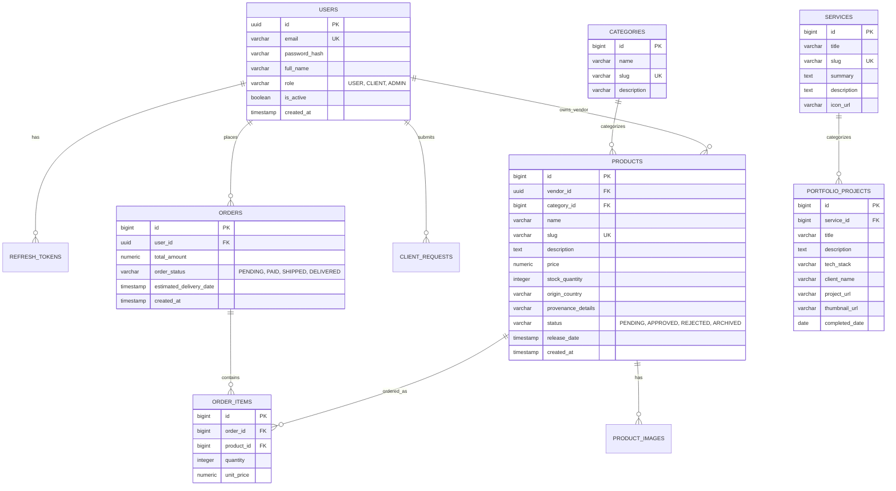

# Business Project Documentation & Technical Specification

## 1. Project Overview & Objectives

This project is a hybrid **E-Commerce and Software Services platform** designed to provide:
1. **E-Commerce Marketplace**: A multi-category catalog of products where customers can purchase goods, track provenance/origin, and view delivery schedules. Verified third-party clients/merchants can also request to showcase and sell their products upon admin approval.
2. **Software Development Agency Services**: A showcase for custom digital solutions (Web & Mobile applications) featuring past portfolio case studies, customer inquiries, and quotation flows.
3. **Role-Based Administration**: An administrative suite providing product lifecycle control (CRUD, scheduled release dates, client submission approvals) and content management for services and platform pages.

---

## 2. Technology Stack Architecture

```
+-------------------------------------------------------------+
|                     UX / UI Design                          |
|                       (Figma)                               |
+-------------------------------------------------------------+
                              |
+-------------------------------------------------------------+
|                    Frontend Layer                           |
|                  React.js (SPA / Vite)                      |
|       - React Router, Axios/Fetch, State Management         |
|       - Tailwind CSS / Material UI / Component System       |
+-------------------------------------------------------------+
                              | REST APIs + JWT
+-------------------------------------------------------------+
|                    Backend Layer                            |
|             Spring Boot (Java 17/21)                        |
|       - Spring Web (REST Controllers)                       |
|       - Spring Security + JWT (Stateless Auth)              |
|       - Spring Data JPA / Hibernate                         |
+-------------------------------------------------------------+
                              | JDBC
+-------------------------------------------------------------+
|                    Database Layer                           |
|                  PostgreSQL Database                        |
+-------------------------------------------------------------+
```

| Layer | Technology | Purpose |
| :--- | :--- | :--- |
| **UX / UI Design** | **Figma** | Wireframing, interactive prototyping, design tokens, responsive layout design. |
| **Frontend** | **React.js** | Single Page Application (SPA), state management, dynamic client-side rendering. |
| **Backend** | **Spring Boot** | Enterprise RESTful API services, business logic, validation, transaction management. |
| **Database** | **PostgreSQL** | Relational database handling ACID transactions, relational integrity, product catalogs, and orders. |
| **Security** | **Spring Security + JWT** | Stateless token-based authentication, Role-Based Access Control (RBAC), password hashing (BCrypt). |

---

## 3. User Roles & Permissions Matrix

| Capability / Feature | Public / Guest | Registered User | Client (Merchant) | Admin |
| :--- | :---: | :---: | :---: | :---: |
| Browse Home, About Us, Services | Yes | Yes | Yes | Yes |
| Browse Released Products & Categories | Yes | Yes | Yes | Yes |
| View Unreleased / Scheduled Products | No | Countdown Only | Countdown Only | Full Access |
| Place Orders & View Order Timeline | No | Yes | Yes | View All |
| Submit Products for Platform Listing | No | No | Yes | N/A (Direct Publish) |
| Review / Approve Product Submissions | No | No | No | Yes |
| Manage Services & Portfolio Projects | No | No | No | Full CRUD |
| Admin Analytics Dashboard | No | No | No | Yes |

---

## 4. Functional Specifications & Features

### 4.1. User Role (Customers & Visitors)

1. **Home Page**
   - Hero banner displaying key brand highlights, promotional campaigns, and featured services.
   - Featured products carousel and new arrivals.
   - Quick preview of software services with "Request a Consultation" CTA.
   - Testimonials and trust badges.

2. **Products & Catalog System**
   - **Categorization**: Multi-level category hierarchy (e.g., Electronics, Fashion, Software Subscriptions, etc.).
   - **Search & Filter**: Keyword search, price range filters, category selection, sorting (price, popularity, newest).
   - **Product Detail Page**:
     - High-res image gallery and technical specifications.
     - Origin & Provenance tracking ("Where it's from").
     - Scheduled release notice for upcoming items with countdown timers.
     - Delivery timeline estimator (expected shipping & arrival dates calculated after checkout).
   - **Cart & Checkout**: Cart management, order confirmation, and payment integration.

3. **Services Page (Software Development Agency)**
   - **Offerings**: Web application development, Mobile app development (iOS/Android), custom business software, UI/UX design.
   - **Portfolio Showcase**: Interactive showcase of completed client projects (screenshots, tech stack used, challenges solved, live demo links) proving delivery capability.
   - **Inquiry Form**: Lead capture form to request quotes and schedule discovery calls.

4. **About Us Page**
   - Company background, mission, values, and manufacturing/sourcing philosophy.
   - Detailed product provenance: Transparency on suppliers, craftsmanship, and raw material origins.
   - Transparent order-to-delivery lifecycle visualization (processing $\rightarrow$ packaging $\rightarrow$ shipping $\rightarrow$ delivery).

5. **Settings (User Account Portal)**
   - Profile management (name, email, avatar, phone).
   - Delivery addresses book.
   - Order history with tracking status and receipt generation.
   - Security settings (change password, active sessions).

---

### 4.2. Client (Merchant / Vendor) Feature Workflow

1. **Product Listing Request Workflow**
   - Clients must register or request Client/Vendor status.
   - **Submission Portal**: Client fills out product details (name, description, images, category, pricing, provenance, inventory count).
   - **Pending Approval Queue**: Submissions enter a `PENDING_REVIEW` state. Products are **not visible** to the public until reviewed.
   - Status updates sent to the client (Approved, Changes Requested, Rejected).

---

### 4.3. Admin Role

1. **Analytics Dashboard**
   - Revenue, order volume, active users, and inventory summaries.
   - Pending client product review notifications.
   - Top-selling products and service inquiry metrics.

2. **Product Management (Full CRUD & Scheduling)**
   - **Create / Edit / Delete**: Manage title, SKU, description, pricing, inventory, images, and category tags.
   - **Release Date Scheduler**: Define specific future release date and time (`release_date`). Before this timestamp, the product remains hidden or in "Coming Soon" teaser mode for public users.
   - **Vendor Review Hub**: Approve, request changes, or reject client-submitted products with feedback comments.

3. **Services & Portfolio Management (CRUD)**
   - Add, edit, or archive service offerings (Web, Mobile, Cloud, etc.).
   - Portfolio project manager: Upload case study imagery, client name, deliverables, completion date, and live URLs.

4. **Home Page & About Us CMS**
   - Update promotional banners, hero copy, and featured showcases without code deployment.
   - Manage company information, provenance details, and FAQ items.

5. **Settings & User Management**
   - User account status (active, suspended, roles assignment).
   - Global platform configuration (tax rates, shipping fees, notification templates).

---

## 5. PostgreSQL Database Schema Design



---

## 6. Security Architecture: Spring Security + JWT

1. **Stateless Authentication Flow**:
   - Client sends credentials (`email`, `password`) to `/api/v1/auth/login`.
   - Spring Security authenticates using `AuthenticationManager` and `BCryptPasswordEncoder`.
   - On success, server generates a signed **JWT Access Token** (short-lived, e.g. 15-30 mins) and a **Refresh Token** (long-lived, e.g. 7 days).
   - Client stores token and passes it in the `Authorization: Bearer <token>` header for subsequent requests.

2. **Security Filter Chain**:
   - `JwtAuthenticationFilter` intercepts requests, validates signature and expiration with HMAC-SHA256/RSA, and populates the `SecurityContextHolder`.
   - Role-Based Access Control (`@PreAuthorize("hasRole('ADMIN')")`, `@PreAuthorize("hasAnyRole('CLIENT', 'ADMIN')")`).

---

## 7. Recommended Project File Structure

```
C:\ecommerce\
├── ecommerce\                          # (Spring Boot Backend Root)
│   └── ecommerce\
│       ├── pom.xml
│       └── src\
│           ├── main\
│           │   ├── java\com\ecommerce\
│           │   │   ├── config\         # SecurityConfig, JwtConfig, WebMvcConfig
│           │   │   ├── controllers\    # Auth, Product, Service, Admin, Order
│           │   │   ├── dto\            # Request and Response payloads
│           │   │   ├── entities\       # JPA Models (User, Product, Order, etc.)
│           │   │   ├── repositories\   # Spring Data JPA Interfaces
│           │   │   ├── security\       # JwtProvider, CustomUserDetailsService
│           │   │   └── services\       # Core Business Logic implementations
│           │   └── resources\
│           │       └── application.yml # DB Connection, JWT Secret, Mail settings
│           └── test\
└── frontend\                           # (React.js Frontend Application)
    ├── package.json
    ├── vite.config.js
    └── src\
        ├── components\                 # Navbar, Footer, Cards, Modals
        ├── pages\
        │   ├── Home\
        │   ├── Products\
        │   ├── Services\               # Web/App services & Portfolio showcase
        │   ├── AboutUs\                # Product provenance & delivery tracker
        │   ├── Settings\
        │   └── Admin\                  # Dashboard, CRUD, Release scheduler
        ├── context\                    # AuthContext, CartContext
        └── services\                   # Axios API client functions
```
